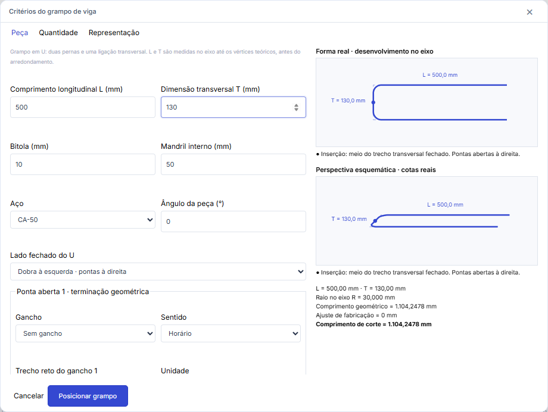
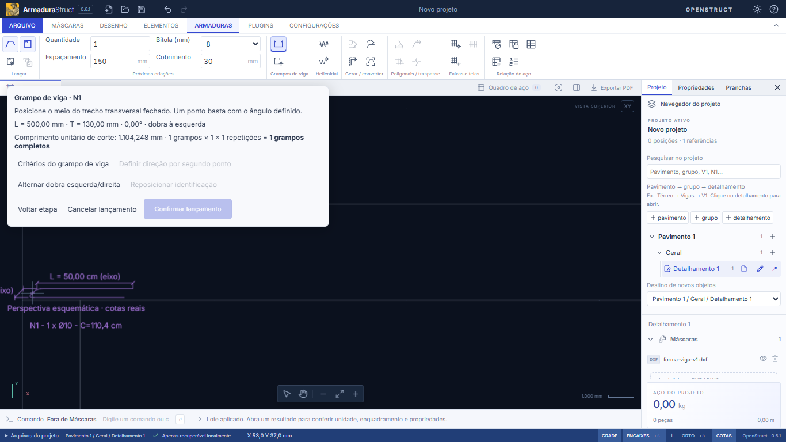
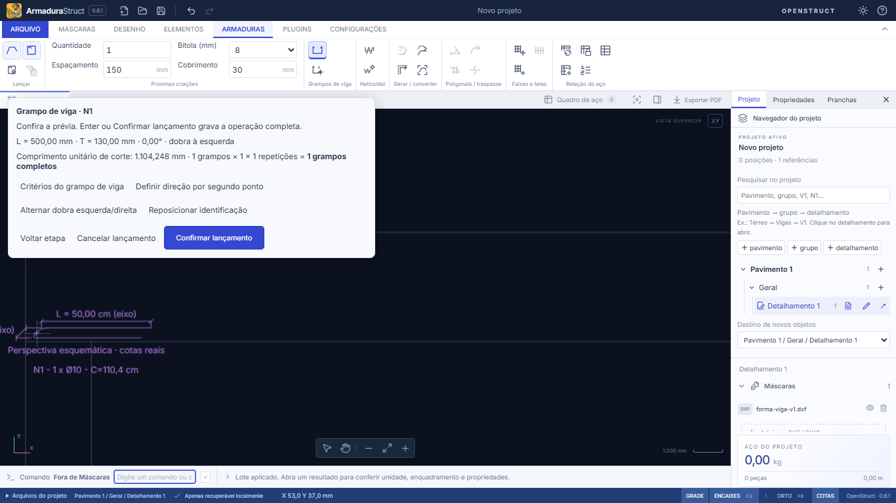
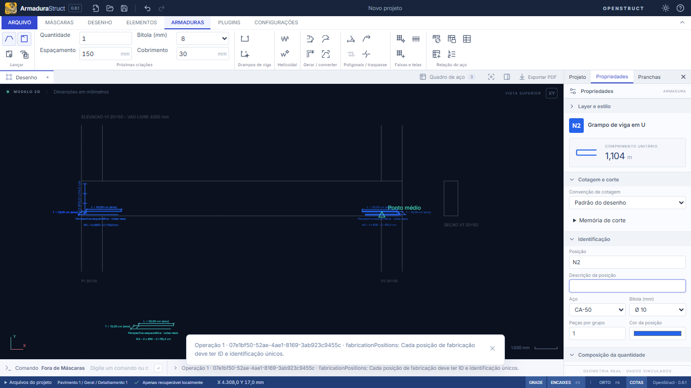
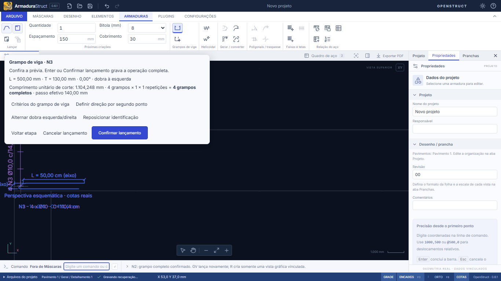
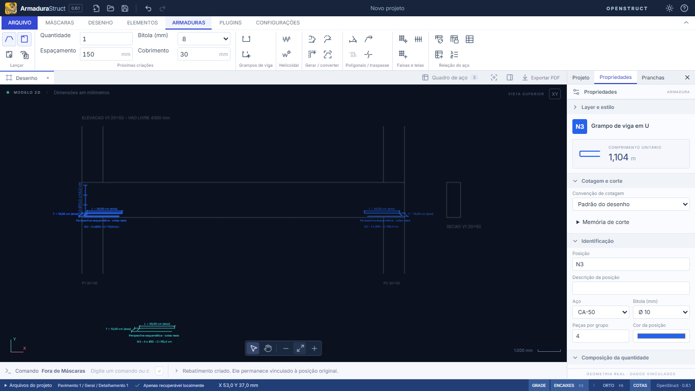

# Usabilidade · Grampo de viga (`beam-clamp`) — issue #180

Relatório de ensaio de uso do lançamento de grampos de viga em U na vista lateral da fôrma. **Não há implementação nesta entrega**: as propostas ao final são hipóteses para discussão.

## 1. Condições do ensaio

| Item                    | Valor                                                                                                                                                                                                                                                                      |
| ----------------------- | -------------------------------------------------------------------------------------------------------------------------------------------------------------------------------------------------------------------------------------------------------------------------- |
| Versão                  | ArmaduraStruct 0.6.1. Ensaio manual em `master` `3ab67ea`; roteiro revalidado sem diferenças de fluxo em `a814d6f` (13/11/2026, após o merge de #194/#195), sem alterações locais                                                                                          |
| Sistema                 | Windows 11 Pro 23H2 (10.0.22631). **Linux não foi testado**                                                                                                                                                                                                                |
| Execução                | Interface web (`npm run dev`, Vite) em navegador Chromium; **aplicativo desktop Tauri não testado**                                                                                                                                                                        |
| Viewport                | 1366 × 768 (notebook)                                                                                                                                                                                                                                                      |
| Quem operou             | Agente de IA (Claude Code) acionando mouse e teclado sintéticos no navegador embutido do aplicativo Claude, com capturas de tela a cada passo. **Não houve detalhista humano**; dúvidas de "primeiro uso" são as de quem lê a interface sem consultar a documentação antes |
| Reprodução              | [`ensaio.spec.ts`](ensaio.spec.ts) repete o fluxo no Microsoft Edge 157 (Chromium) via Playwright 1.58.2 e gera as capturas desta pasta                                                                                                                                    |
| Arquivo de partida      | [`forma-viga-v1.dxf`](forma-viga-v1.dxf) (SHA-256 `89e5ad55…66b3`): elevação da V1 20×50, vão livre de 4.000 mm entre P1 e P2 (30×30), e seção 20×50; 16 entidades, mm                                                                                                     |
| Peça ensaiada           | Grampo em U, Ø10 CA-50, mandril 50 mm, L = 500 mm, T = 130 mm (= 200 − 2·25 cobrimento − 2·5 estribo − 10 bitola)                                                                                                                                                          |
| Alterações em andamento | Conferidos #194 (faixa sem traços, integrada durante o ensaio: só estribos), #191 e #192/#195 (sem efeito no grampo)                                                                                                                                                       |

**Tempos.** Não foram medidos tempos humanos, porque o operador foi um agente. O roteiro automatizado registra apenas o tempo de máquina ([`tempos-maquina.json`](tempos-maquina.json): 0,8 s / 0,2 s / 0,3 s por cenário). Isso mostra que o aplicativo responde de imediato, mas **não** representa a rapidez de um usuário. A seção 6 traz um protocolo curto para a cronometragem humana.

## 2. Cenários e evidências

Passos reproduzíveis: abrir o app, importar `forma-viga-v1.dxf` em **Máscaras → Adicionar DXF/DWG** (Ler arquivos → Aplicar lote), aba **Armaduras**, **Ajustar à tela**.

### Cenário 1 — primeiro grampo (apoio P1), primeiro uso

Sequência observada:

1. **Armaduras → Grampo de viga** (ícone com rótulo de grupo "Grampos de viga"; atalho `GV`). No primeiro uso abre-se a janela de critérios. 
2. Ajustar L = 500 e T = 130 na aba **Peça** (padrão: 600 × 300). A prévia da janela atualiza o comprimento: 2·500 + 130 − 4·30 + 30π = **1.104,248 mm**, conferido à mão.
3. **Posicionar grampo**. O painel de lançamento abre sobre o canto superior esquerdo do desenho. 
4. Aproximar o zoom no P1 (roda do mouse; a prévia continua seguindo o cursor) e informar o ponto `50,40` (meio do trecho transversal fechado, dentro do pilar, camada inferior). 
5. Enter (confirma). Um segundo Enter **não** duplicou a peça: o quadro ficou com 1 posição.

Mínimo de ações: 4 cliques/Enter + 2 campos. A mensagem final ("GV lança novamente; R cria somente uma vista gráfica vinculada") orienta bem o próximo passo.

Atritos concretos:

- **T exige conta manual.** A janela pede medidas pelo eixo, coerente com a convenção documentada, mas o detalhista parte da seção de concreto (20 cm) e precisa calcular 130 mm. O padrão T = 300 mm é maior que a largura da viga ensaiada. Não houve erro, só um passo mental a mais.
- **O painel cobre a região de trabalho.** A 1366 × 768, o painel (~560 × 245 px) fica sobre o canto superior esquerdo do canvas. Ao aproximar o zoom no apoio esquerdo, a face superior da viga e o topo do pilar ficaram sob o painel (captura 02). O mesmo componente visual é usado pelos estribos (`stirrup-launch-panel`); ver a avaliação equivalente em #178.
- **Clique acidental vira ponto.** Durante o ensaio, uma mudança no tamanho da janela fez um clique destinado ao botão **Ajustar à tela** cair no canvas. O app tomou esse clique como ponto de inserção. **Voltar etapa** recuperou sem resíduo. Como um único ponto conclui a captura, o custo de um clique errado é baixo, mas ele passa despercebido se o usuário não olhar a prévia.
- **Entrada em mm, cotas em cm.** É a convenção do projeto (AGENTS.md, regra 3: cotas gráficas em cm), não um defeito. Registro apenas que o painel mostra L = 500,00 mm e o desenho L = 50,00 cm.

### Cenário 2 — repetir no apoio P2 (familiaridade)

`GV` → ponto `4550,40` → **Alternar dobra esquerda/direita** → **Confirmar lançamento**. São 4 ações, sem reabrir critérios. A alternância espelha a prévia na hora, em torno do ponto de inserção, sem recomeçar.

Atritos:

- **Alternar dobra só pelo mouse.** Não há tecla durante a prévia. `F`, que um usuário poderia tentar, é **Enquadrar** e não alterna a dobra.
- **A dobra alternada vira critério do próximo lançamento.** Depois de lançar no P2 com dobra à direita, o próximo `GV` (de volta ao P1) já veio com "dobra à direita" (captura do roteiro, cenário 3). É coerente com "reutilizar os últimos valores", mas, para quem alterna apoio esquerdo e direito, o padrão fica errado com frequência.
- **Peça idêntica recebe nova marca.** O grampo do P2 virou **N2**, com L, T, Ø, aço e mandril idênticos ao N1. O quadro lista N1 = 1 e N2 = 1 (total correto: 2,21 m; 1,36 kg). Tentativas de unificar:
  - Renomear N2 para N1 nas propriedades é recusado com mensagem técnica: "Operação 1 · <id> · fabricationPositions: Cada posição de fabricação deve ter ID e identificação únicos." 
  - **Renumerar** só reordena (N1/N2/N3) e não consolida.
  - **Copiar (`C`)** criou nova posição (N4), conforme o GUIA ("Copiar cria outra posição").
  - O caminho previsto pelo modelo do app seria N1 com quantidade 2 mais um **rebatimento** (`R`) no P2. Porém o rebatimento só tem X/Y nas propriedades, sem lado fechado próprio, e é desenhado com as pontas para o lado errado no apoio direito.

### Cenário 3 — vários grampos acima (P1), com espaçamento

Objetivo: 4 grampos empilhados na altura da viga, do eixo inferior (y = 40) ao superior (y = 460), passo máximo de 20 cm.

Sequência: `GV` → **Critérios do grampo de viga** (no painel) → corrigir a dobra herdada → aba **Quantidade** → **Distribuir grampos em uma faixa** (passo máximo 200 mm já padrão) → **Posicionar grampo** → ponto de inserção `50,40` → início da faixa `50,40` → fim da faixa `50,460` → Enter. São **10 ações** (9 sem a correção da dobra).

Resultado: "4 grampos × 1 × 1 = 4 grampos completos · passo efetivo 140,00 mm" (420 / 3), conferido à mão. Quadro: N3 = 4 × 1,104 = **4,417 m**; total do projeto de 6,63 m e 4,08 kg, conferidos. 

Atritos:

- **O mesmo ponto é pedido duas vezes.** O grampo inferior é, na prática, o início da faixa, mas o fluxo pede inserção e início da faixa separadamente.
- **A quantidade e o passo ficam na janela de critérios**, não no painel de lançamento. É preciso sair da prévia, navegar abas e voltar.
- **A distribuição continua ligada nos lançamentos seguintes.** No `GV` seguinte o painel já pediu o início da faixa. Para voltar a um grampo isolado é preciso reabrir os critérios e desmarcá-la (+3 ações).
- **Representação da faixa.** Só o grampo inferior é desenhado; os demais aparecem como traços sobre uma linha vertical, com o texto "4 N3 Ø10,0 c/14,0 cm" girado 90°. O topo da faixa ficou sob o painel nesta resolução. Sobre a representação de faixas em geral, ver #182.

### Rebatimento (clique separado)

Com o N3 selecionado, `R` → ponto `800,-1600` → "Rebatimento criado. Ele permanece vinculado à posição original." O quadro não mudou (sem aço extra), e Desfazer/Refazer removeu e restaurou rebatimento e grampo na ordem certa. O rebatimento repete a perspectiva; trocar para desenvolvimento plano é uma propriedade da representação, ajustada depois. Para o fluxo geral de rebater, ver #187. 

### Cancelar, Esc, desfazer e recuperação

| Verificação                                      | Resultado                                     |
| ------------------------------------------------ | --------------------------------------------- |
| Esc na etapa de faixa (após o ponto de inserção) | Passou: painel fechado, quadro inalterado     |
| Voltar etapa após ponto errado                   | Passou: volta à captura do ponto, sem resíduo |
| Enter repetido na confirmação                    | Passou: não duplica                           |
| Desfazer/Refazer (grampo + rebatimento)          | Passou                                        |
| Zoom com a roda durante a prévia                 | Passou: prévia mantida                        |
| PAN arrastando durante a prévia                  | Não executado (fora do escopo; ver #175)      |
| Erros de página (`pageerror`) no roteiro         | Nenhum                                        |

### Geometria, representação e quantitativos

Corte unitário, quantidades e massa conferem com o cálculo manual em todos os cenários. Nenhuma interação (alternar dobra, rebatimento, zoom, Voltar, Esc) alterou corte ou quantidade. Representação na vista ajustada à tela (captura 05):

- O texto "T = 13,00 cm (eixo)" fica fora da fôrma, à esquerda do P1. A identificação e a legenda "Perspectiva esquemática · cotas reais" ficam abaixo da face inferior da viga, sobre as linhas do pilar.
- _Inspeção de código, não ensaio:_ em `beamClampViews.ts`, os afastamentos dos textos são fixos em mm do modelo (50, −70, 100). A legenda é exibida junto com as cotas e não tem controle próprio.

## 3. Comparação

| Produto                          | Fonte                                                                                                                                                                                                                                                                                                                                                                                                                                                                                                                                                                                                                              | O que foi observado                                                                                                                                                                                                                                                                                                                                                                                                                                                                                                                           | Limites                                                                                                                                                                                    |
| -------------------------------- | ---------------------------------------------------------------------------------------------------------------------------------------------------------------------------------------------------------------------------------------------------------------------------------------------------------------------------------------------------------------------------------------------------------------------------------------------------------------------------------------------------------------------------------------------------------------------------------------------------------------------------------- | --------------------------------------------------------------------------------------------------------------------------------------------------------------------------------------------------------------------------------------------------------------------------------------------------------------------------------------------------------------------------------------------------------------------------------------------------------------------------------------------------------------------------------------------- | ------------------------------------------------------------------------------------------------------------------------------------------------------------------------------------------ |
| Autodesk Revit 2021–2023         | Documentação oficial: [Place Rebar (2021)](https://help.autodesk.com/cloudhelp/2021/ENU/Revit-StructEng/files/GUID-D61AF551-AD15-4FEC-966F-C048E0885212.htm), [Place a Rebar Set (2021)](https://help.autodesk.com/cloudhelp/2021/ENU/Revit-StructEng/files/GUID-7275163F-54C6-4684-99A5-7A61D7B1D061.htm), [Place Rebar – By Two Points (2023)](https://help.autodesk.com/cloudhelp/2023/ENU/Revit-StructEng/files/GUID-C5F00668-26DA-4F41-908E-A41F3C6AF43A.htm), [Remember Settings when Placing Rebar (2022)](https://help.autodesk.com/cloudhelp/2022/ENU/Revit-WhatsNew/files/GUID-3D5A9E00-78BC-4C87-BC0C-464777AC1284.htm) | Forma (ex.: U) escolhida antes; plano de colocação por cobrimento; **Espaço gira/alterna a orientação durante a colocação** e também depois, com a barra selecionada. O **layout do conjunto** (Fixed Number, Maximum Spacing, Number with Spacing, Minimum Clear Spacing) e a quantidade/passo ficam na faixa de opções _antes do clique_, e o conjunto é criado perpendicular ao plano da barra. Desde 2022, forma, layout, plano e orientação são lembrados durante a sessão. "By Two Points" dimensiona a forma pela caixa de dois pontos | Só documentação, sem ensaio nem licença. Revit é BIM 3D com hospedeiro e cobrimento; o ArmaduraStruct é detalhamento 2D sem vínculo estrutural, então tempos e passos não são equiparáveis |
| TQS (Editor de armação de vigas) | Manuais oficiais em [docs.tqs.com.br](https://docs.tqs.com.br/Docs/PrintAllReport/3778) ("Vigas"), 3779, 3886, 3902 e 3802                                                                                                                                                                                                                                                                                                                                                                                                                                                                                                         | **Lacuna:** o texto extraído desses PDFs não contém a palavra "grampo"; não localizei documentação oficial do lançamento de grampo de viga                                                                                                                                                                                                                                                                                                                                                                                                    | Comparação com a TQS bloqueada; nenhum procedimento foi suposto                                                                                                                            |

O que a referência documentada sugere, sem afirmar superioridade: (a) alternar a orientação **por tecla durante a colocação** e (b) definir quantidade/passo **no próprio contexto de colocação**, antes do clique, são padrões consolidados em outro produto. Os dois coincidem com os atritos dos cenários 2 e 3.

## 4. Avaliação da proposta da issue (hipótese, não implementada)

Proposta: 1º clique no grampo inferior; 2º clique define lado/orientação; quantidade e espaçamento (repetições acima); clique separado para o rebatimento.

| Etapa proposta                             | Situação atual                                                                                                        | Avaliação                                                                                                                                                                                                                                                                                                                       |
| ------------------------------------------ | --------------------------------------------------------------------------------------------------------------------- | ------------------------------------------------------------------------------------------------------------------------------------------------------------------------------------------------------------------------------------------------------------------------------------------------------------------------------- |
| 1º clique no grampo inferior               | Já é assim (ponto = meio do trecho fechado)                                                                           | Adequado. Com distribuição, esse ponto também deveria ser o início da faixa, eliminando a captura repetida (−1 ação)                                                                                                                                                                                                            |
| 2º clique para lado/orientação             | Lado por botão (só mouse); direção por botão + 2º ponto; ângulo nos critérios                                         | **Recomendado.** Um 2º ponto "para onde vão as pontas" resolve ao mesmo tempo ângulo e lado fechado, e serve igual para P1, P2 e vigas inclinadas. Mantém a regra "não altera L/T". Risco: o grampo isolado com ângulo já definido hoje fecha em 1 ponto. Sugestão: o 2º ponto seria opcional (Enter aceita o atual), como hoje |
| Quantidade e espaçamento, repetições acima | Na janela de critérios (aba Quantidade) + 2 pontos de faixa                                                           | **Recomendado**: quantidade/passo editáveis no painel e um 3º ponto opcional para o topo da faixa (início = 1º ponto). Benefício estimado: de ~10 para ~5 ações no cenário 3. Dependência: #182 (faixas). Cuidar para não reaplicar o multiplicador e manter "L não é faixa; T não é passo"                                     |
| Clique separado para rebatimento           | `R` com a peça selecionada + 1 ponto                                                                                  | O fluxo já existe e funciona sem somar aço. Falta escolher no rebatimento a vista (perspectiva/desenvolvimento) e o **lado fechado**, para que um rebatimento sirva ao apoio oposto. Relacionar com #187                                                                                                                        |
| Identificação enxuta                       | "N1 - 1 x Ø10 - C=110,4 cm" + "L = … cm (eixo)" + "T = … cm (eixo)" + legenda "Perspectiva esquemática · cotas reais" | **Com cautela**: a legenda e o "(eixo)" repetido poderiam ir para uma nota única do desenho, com controle próprio, mantendo L e T visíveis. Não remover a indicação de que as cotas são pelo eixo sem substituto: é informação estrutural de fabricação                                                                         |

Proposta de fluxo resumida (hipótese):

```text
GV → [1º ponto: grampo inferior] → [2º ponto opcional: direção das pontas]
   → (painel: quantidade | passo máx. — editáveis sem sair da prévia)
   → [3º ponto opcional: topo da faixa] → Enter
R  → [ponto do rebatimento] → (vista e lado fechado no painel) → Enter
```

## 5. Melhorias priorizadas

Constatações (C) separadas de hipóteses (H):

| #   | Melhoria                                                                                                                                                                                                                                      | Base                             | Prioridade e justificativa                                                                                 | Riscos / dependências                                                              |
| --- | --------------------------------------------------------------------------------------------------------------------------------------------------------------------------------------------------------------------------------------------- | -------------------------------- | ---------------------------------------------------------------------------------------------------------- | ---------------------------------------------------------------------------------- |
| 1   | Permitir representar o **mesmo grampo** nos dois apoios sem nova marca (rebatimento com lado fechado próprio, ou cópia "equivalente" que mantenha a posição) e trocar a mensagem técnica `fabricationPositions` por uma orientação ao usuário | C (cenário 2)                    | **Alta**: caso comum (dois apoios); hoje gera posições duplicadas no quadro e uma mensagem incompreensível | Regras de identidade de fabricação (AS-51/52); não fundir peças diferentes         |
| 2   | Inserção = início da faixa; quantidade/passo no painel                                                                                                                                                                                        | C (cenário 3) + H (fluxo)        | **Alta**: corta ~metade das ações do cenário "vários acima"                                                | #182; manter a separação L/T × faixa                                               |
| 3   | 2º ponto opcional para direção e lado; tecla para alternar a dobra na prévia                                                                                                                                                                  | C (cenário 2) + referência Revit | **Média**: atrito por apoio; baixo risco                                                                   | Definir uma tecla livre (`F` é Enquadrar); atalhos centralizados em `shortcuts.ts` |
| 4   | Não herdar lado fechado e distribuição como padrão silencioso: ou voltar ao padrão, ou mostrá-los em destaque no painel antes do 1º ponto                                                                                                     | C (cenários 2 e 3)               | **Média**: causa retrabalho ou um lançamento errado que passa despercebido                                 | Conflita com "reutilizar últimos valores" (#134); decisão do mantenedor            |
| 5   | Painel de lançamento menos intrusivo em 1366 × 768 (recolhível ou ancorado fora da área útil)                                                                                                                                                 | C (capturas 02 e 04)             | **Média**: esconde justamente o topo da viga nos apoios                                                    | Componente compartilhado com estribos (#178)                                       |
| 6   | Identificação/cotas com afastamento proporcional à escala e legenda opcional                                                                                                                                                                  | C (captura 05) + H               | **Baixa**: estético e de legibilidade; não altera aço                                                      | Prancha/PDF/DXF compartilham a apresentação                                        |
| 7   | Ajuda opcional para T a partir da seção (largura − cobrimentos − estribo − bitola), com conversão explícita para a convenção pelo eixo                                                                                                        | C (cenário 1) + H                | **Baixa**: previsto em #134 como evolução futura                                                           | Não misturar dimensão de concreto com a convenção pelo eixo                        |

## 6. Resumo

- **Passou:** descoberta pelo menu/`GV`; critérios claros, com a fórmula e o comprimento exibidos; grampo isolado em 1 ponto; alternar dobra sem reiniciar; Voltar etapa, Esc, Enter repetido, Desfazer/Refazer; rebatimento sem somar aço; quantitativos corretos em todos os casos.
- **Atritos (sem perda de precisão):** quantidade/passo fora da prévia e ponto repetido na faixa; dobra e distribuição herdadas; painel sobre a área de trabalho; alternar só pelo mouse; mesmo grampo nos dois apoios vira duas posições, e a unificação manual é bloqueada com mensagem técnica.
- **Conclusão simples:** para **um grampo**, o fluxo é simples e rápido depois do primeiro uso (4 ações). Para **vários grampos acima** e para o **apoio oposto**, é trabalhoso e diverge do raciocínio do detalhista ("este é o N1, nos dois apoios, 4 acima a cada 14 cm").
- **Não executado:** Linux; aplicativo desktop Tauri; ensaio com usuário humano e cronometragem; PAN arrastando; vigas inclinadas ("Definir direção por segundo ponto"); comparação direta com a TQS (documentação não localizada).

Protocolo sugerido para completar com um detalhista (Linux e Windows): partir de `forma-viga-v1.dxf`, cronometrar cada cenário duas vezes (primeira vez e repetição), anotar dúvidas e ações a mais, e registrar as mesmas verificações da tabela da seção 2.

Relação com outras issues: #134 (origem do comando), #178 (painel de lançamento compartilhado), #182 (faixas), #187 (rebater), #175 (PAN/travamentos) e #174 (ícones; o botão da faixa de comandos não tem rótulo próprio, só o do grupo).
